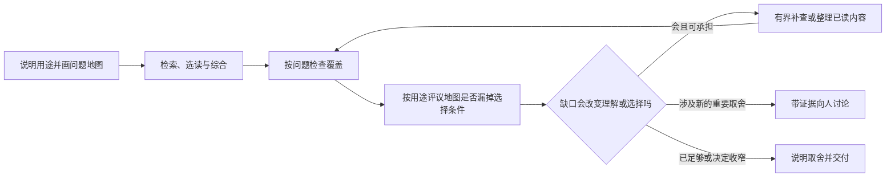

# 综述的覆盖与收束：从问题地图决定下一步

当一份综述已经有清楚主线，却还需要判断是否漏掉重要路线、是否继续阅读时，使用这条流程。它接在[综述优先](review-first-preparation.md)的查找与综合之间，也适用于需要补文献的定向问题。

## 1. 先确定地图服务什么

| 本轮用途 | 地图应覆盖什么 | 合理结束的条件 |
|---|---|---|
| 定向证据综合 | 会改变当前问题解释、方法或下一行动的关系 | 关键选择有依据，剩余问题和处理办法清楚 |
| 领域导览 | 对象、测量、主要路线和彼此关系 | 读者能辨认主干与支路，知道何时沿哪条路线继续 |
| 方法地图或教程 | 不同信息条件、建模假设、评价及替代路线 | 主要选择关系有依据，未展开的分支有取舍理由 |

同一主题可以选择不同用途。先说明读者希望理解什么或决定什么，再画地图。系统综述、荟萃分析等任务继续采用相应协议；这里的地图协助组织当前问题。

需要判断文献回答了什么时，将背景中的关键问题、作者明确目的、实际方法与结果，以及承担讨论或总结功能的段落对读。区分领域动机、论文承担的工作、当前可支持结论、限制和未来研究，再按本轮用途确定必须接通的关系。

起稿与铺图所用模型和推理强度，依据当前任务、资源和实际表现选择。首次地图和初稿完成后，再按关键争议、版本判断或方法取舍分配核证投入。历史试验中的模型档位及成绩按各自记录保留。

## 2. 用关系命名分支

地图可以是一页表格，也可以使用[机器模板](../../../examples/research-support/preparation/review-map.template.json)。每个分支写明：

- 要澄清的问题，例如“标签稀少而关联网络已知时，可以使用什么信息”；
- 它为什么影响本轮理解或选择，以及是否是本轮用途所必需；
- 支持它的来源、发现和主文位置；
- 当前缺什么，以及继续投入后可能改变什么。

方法名称可以帮助查找，分支应体现条件和选择。同一假设下的算法变体归在一起；输入资格、目标事件或使用决定不同，可以另立分支。地图从任务、已有知识和新证据逐步生长，按重要改变保留版本和原因。先保存首次地图，进入补查和收束时再保留快照。

## 3. 检查问题到了哪一步

| 状态 | 怎样识别 | 优先动作 |
|---|---|---|
| 尚未定向检索 | 还没有围绕此关系查找依据 | 先判断它是否值得本轮投入 |
| 只有元数据或提名 | 知道论文或方法名，尚未读到支持关系的材料 | 定位合适版本并选择相关部分 |
| 关键材料不可得 | 原件、版本或必要支持材料受限 | 尝试合法替代，或说明缺口并收窄 |
| 已读，尚未综合 | 相关内容已有阅读定位，主文仍缺条件、替代或含义 | 先整理已读内容，再决定是否继续下载 |
| 已形成综合 | 有文献位置和适用条件，并进入主文的论证或选择关系 | 核对证据范围及剩余竞争解释 |
| 明确排除 | 本轮用途已说明为什么不展开 | 保留分支及理由，后续用途变化时再评议 |

检查“生物对象或目标—数据条件—方法假设—评价—选择”是否接起来。引用增加、全文已经下载、主文有某个算法名称，分别说明获取或提名进度。要形成综合，还需要解释相关关系，并定位到实际使用的内容。

每个关键分支连接来源账本、证据图中的发现和主文短摘录。来源的取得状态、阅读位置和主文使用位置分别记录。科学评议仍要判断证据是否支持所述关系；程序协助检查这些记录是否连通。

## 4. 在宽用途下，检查地图有没有漏掉问题

领域导览和方法地图通常从少数宽分支起步。各枝都有综合后，再用一次有界评议挑战地图的范围：哪些信息条件会改变方法、评价或允许的主张，却还没有在图中表示？当新来源暴露这类条件，或准备声称主要关系已足够时，也可以触发这一步。问题明确、范围狭窄的任务可以说明已有边界为何足够。

优先回看已读来源中的方法取舍、数据处理与讨论。已有内容未进入论证时，先整理它。若仍缺少横向视角，再选合适的基础论文、教程或宽视角来源，沿原有来源资格与投入上限补查。应用实例说明某条路线怎样工作；基础比较帮助识别路线之间的选择条件，两者按用途互补。

若补查持续集中在少数分支，或已固定交付仍缺选择依据，可沿[重读与视角切换](review-choice-synthesis.md#固定交付后主动重读相关原文)完整重读相关原文，再复查遗漏、缺分析和注意分配。已有范围与论证合理时继续保留，结果接回本节的处理决定。

只保留会改变本轮理解或选择的候选条件，写清“来源位置—尚未表示的条件—可能改变的选择—处理决定”。沿现有分支和动作记录即可：

| 评议结果 | 接下来怎样处理 |
|---|---|
| 已有分支缺少重要条件 | 补回条件、替代及其依据，必要时先整理已读材料 |
| 出现用途所需的新关系 | 加入地图，按价值选择有界动作 |
| 候选与本轮用途无关，或合理替代已足够 | 说明理由并保留排除或较窄用途 |
| 新关系改变方向或重要投入 | 带着证据、选项与建议向人讨论 |
| 没有发现会改变选择的遗漏 | 记录所据材料和范围判断，继续原收束决定 |

把已读来源中影响选择的关系接到综合。逐来源说明原作者实际报告了什么，跨来源的比较另写为综合。写“补查改变了结论”前，对照初稿指出新增了哪个条件或撤回了哪项判断；原稿已有限定时，可以直接说明这次把条件讲得更具体。

范围评议保留研究者判断：明确用途、证据和取舍即可，分支数与论文数随问题而定。可以使用一页表格，也可填写可选的 `scope_appraisal`。它正在进行时先完成评议或调整交付用途；完成后仍按关键分支的实际状态决定是否继续。

## 5. 为值得处理的缺口选择一项有界动作

先按下表选路线，再写一个能改变选择的预期结果。优先级来自缺口的影响与补充价值。

| 缺口 | 可选路线 | 选择理由与替代 |
|---|---|---|
| 已读内容还没进论证 | 整理已有证据 | 来源可用时先补条件和含义；发现关键材料未读再转获取 |
| 方法基础不清楚 | 扩展来源路线 | 按问题补机器学习会议、基础论文、教材或协议；已有可靠原始研究可满足时直接使用 |
| 原件或版本不可得 | 定向取得合格材料 | 原始补充材料、合法作者稿或其他等价证据可作替代，实际版本分别记录 |
| 不同论文结论冲突 | 对齐条件并补核证 | 先比较对象、测量、信息使用与评价；关键新观察再决定是否值得获取 |
| 新用途或重要投入需要选择 | 向人解释并讨论 | 带上已有依据、可选方向、推荐和改变选择的条件 |
| 补充价值低或代价过高 | 收窄、暂缓或结束 | 说明保留的用途、未覆盖关系与恢复条件 |

每项动作写明责任人、要补的关系和预计怎样改变决定，按任务价值与资源条件约定进度检查点。确有显式硬预算时，写明任务或资源依据、计入范围和恢复责任，并由有界任务工具或等效平台执行；既有明确授权预算继续遵守。整理已读内容可以直接使用现有材料。

检查点或预算到达时，保存实际耗时、新增材料、执行回执与未决工作，重新比较继续投入、收窄或讨论的价值。将“获取成功”“已读”“进入论证”“改变选择”分别更新；证据充分性按本轮用途与关键关系判断，累计耗时和材料数用于说明投入。具体时间与恢复约定见[续跑指南](task-continuity.md#时间预算与恢复)。

## 6. 把收束理由写给读者

| 下一步 | 适用条件 | 需要交代什么 |
|---|---|---|
| 交付综述 | 本轮用途的关键关系已有支持 | 核心判断、主要依据、重要取舍和仍开放的非关键问题 |
| 继续定向补查 | 有价值的关键缺口仍可在边界内处理 | 具体问题、路线、责任人与预算 |
| 讨论选择 | 研究意义、优先级、用途或重要投入需要人判断 | 已有依据、可行选项、推荐与改判条件 |
| 收窄范围 | 较窄的用途可由当前证据支持 | 新旧范围、改变理由和保留的空白分支 |
| 暂缓或停止 | 关键资料不可得或继续投入价值低 | 已获得的认识、尚未解决的关系和恢复条件 |

收束时回到原问题，说明新证据怎样保留、反驳或收窄原前提，当前贡献与尚未回答内容各是什么。作者总结要与方法、结果及相关复核对应；本轮未履行的必要工作继续保留，另列为未来研究时需有明确的范围决定。

收束说明同时交代已列分支到了哪一步，以及本轮怎样判断地图范围是否足够。关键分支尚未解决时，可以交付一份有用的阶段总结，再明确选择补查、讨论或暂缓；完整性判断按当前用途保留。用途改变时，用新版本保留旧地图和原交付，说明哪些关系因此改为以后处理。

将结论连回[研究推进主线](research-guidance-cycle.md)。常规补查沿已有授权执行；新的研究方向或重要约束变化，带着依据与建议回到实际讨论。

## 将已读条件写进正文

来源已经读到、正文仍只有方法名称时，使用[方法取舍指南](review-choice-synthesis.md)：固定目标改变输入条件，再检查目标变化怎样改变评价，交付新的论证或一页比较表。它也帮助拆开复合问题，分别选择重综合、补读或科学验证。参见[输入与目标工作例](../../../examples/research-support/preparation/choice-synthesis-example/README.md)及[单细胞旧例](../../../examples/research-support/preparation/choice-synthesis-example/mast-resynthesis.md)。

## 工具与工作例

[覆盖小例](../../../examples/research-support/preparation/coverage-example/README.md)演示三种出口：先整理已读内容、综合后交付、在较窄用途下保留未展开分支。机器接口见[覆盖契约](../../../machine/design/review-coverage.json)，设计与观察依据见[D55](../../design/32-review-coverage-and-closure.md)。范围评议的设计与本次独立研究反馈见[D56](../../design/33-review-map-scope-appraisal.md)，可运行入口见[范围评议小例](../../../examples/research-support/preparation/coverage-example/scope-appraisal.md)。已有文献管理平台或一页表格能够保留同样的关系、状态、取舍与实际结果时，可以继续沿用。
